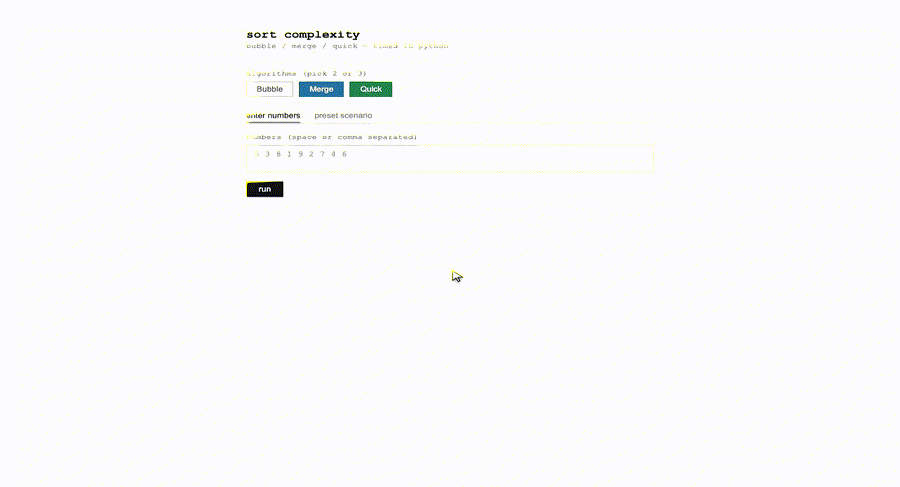

<div align="center">

# 📊 Algo Complexity Visualizer

**A sorting-algorithm benchmarking tool — pick up to three of Bubble, Merge and Quick Sort, feed them your own array or a generated test scenario, and see them timed live by a Python/Flask engine with bars, a winner and an explanation of *why* it won.**

**A 1st-year team project: React frontend + Flask backend.**


</div>

---

## 🎬 Demo (33 seconds — real run)



> 📥 Watch the full video: [`demo/algo-visualizer-demo.mp4`](demo/algo-visualizer-demo.mp4)

---

## ✨ What it does

| Feature | Description |
|---|---|
| 🧮 **Pick 2–3 algorithms** | Bubble, Merge and Quick Sort — implemented in Python, timed on the server |
| ⌨️ **Your own numbers** | Type a comma/space-separated array in the UI |
| 🧪 **5 preset scenarios** | random · already sorted · reverse sorted · nearly sorted · lots of duplicates (n = 300) |
| 📊 **Live comparison bars** | Every algorithm's time in ms, scaled relative to the slowest — the winner is tagged **← faster** |
| 🧠 **Automatic insight** | The backend explains *why* the result happened, not just which number is smaller |
| 🔍 **Verification** | The sorted array is shown so you can confirm correctness |

### The insight engine is the fun part

Timing alone can mislead, so the backend measures **more than time** before it explains a result — for a merge-vs-quick comparison it counts the array's **inversions** (how sorted it really is) and the **unique-value ratio**, then picks the explanation:

- *Reverse-sorted input* → "worst case for first-element pivot Quick Sort — every partition picks the minimum, creating n² recursive calls. Merge Sort's fixed halving is completely immune."
- *Heavy duplicates* → "Quick Sort's in-place swaps are cheaper than Merge Sort's repeated array allocation."
- *Random data* → "Quick Sort's ideal case — first-element pivot partitions well when values are shuffled."
- *Nearly identical times* → "Both O(n log n) strategies converge — Merge's guaranteed halving and Quick's cache-friendly swaps balance out."

The demo video shows this live: on **reverse sorted** input Merge wins (0.303 ms vs Quick's 1.419 ms), but on **lots of duplicates** Quick flips ahead (0.132 ms vs 0.288 ms) — same algorithms, different data.

## 🏗️ How it's built

```
React UI (Vite)                Flask API (:5050)
┌──────────────────┐   POST    ┌────────────────────────────┐
│ algorithm picker │  /sort    │ bubble_sort / merge_sort / │
│ custom array     │ ───────▶  │ quick_sort (pure Python)   │
│ scenario + n     │  /scenario│ time_sort → trimmed mean   │
│ bars + insight   │ ◀───────  │ build_insight (inversions) │
└──────────────────┘   JSON    └────────────────────────────┘
```

- **Frontend** — React 19 + Vite: selection state, mode tabs, fetch with loading/error handling, relative bars computed from the max time
- **Backend** — Flask + flask_cors: three hand-written sorting implementations, scenario generators, and the benchmarking engine
- **Honest timing** — every algorithm runs **7 times**, the fastest and slowest runs are **trimmed away**, and the remaining runs are averaged (`time.perf_counter()`) — so one OS hiccup doesn't decide the winner

## 😅 Challenges we faced & how we solved them

**1. Quick Sort crashed with `RecursionError` on big inputs.**
Our quick sort picks the first element as pivot, so sorted/reverse inputs of a few hundred items blew past Python's default recursion limit.
**Fix:** raised the limit with `sys.setrecursionlimit(100000)` — and still kept a `try/except RecursionError` fallback so the tool never dies on a pathological input (it degrades gracefully instead of showing an error).

**2. The React UI couldn't talk to Flask at all.**
The frontend runs on Vite's port (5173/5181) and Flask on 5050 — two different origins, so every fetch was blocked by the browser's CORS policy.
**Fix:** `flask_cors.CORS(app)` on the backend. Our first lesson that browsers restrict cross-origin requests *by design*.

**3. Timings were so noisy the winner changed between clicks.**
A single `time.perf_counter()` measurement of one run made Bubble sometimes "win" on random data — pure noise.
**Fix:** run each algorithm **7 times**, sort the samples, **trim the fastest and slowest** (they're the most distorted), and average the rest. Now the winner is stable and the insight text stays honest.

**4. The tool implied Bubble Sort is always slow — even when it wasn't.**
On n = 10 the three algorithms finish in microseconds and the bars looked arbitrary, but the UI had no context.
**Fix:** `build_insight` measures the *input shape* (inversions + unique ratio) and writes a scenario-aware explanation — including the honest case that "both strategies converge" at small n. The numbers stopped lying because we added context around them.

**5. Merge and Quick needed exactly 2+ algorithms selected.**
Clicking toggles allowed deselecting down to one algorithm, which broke the comparison UI.
**Fix:** clamp the selection in `toggle()` — you can't go below 2 or above 3, and changing selection clears the stale result.

## 📖 What we learned

- **Big-O and reality are related, not equal** — Bubble's O(n²) vs Merge's O(n log n) only shows at n = 300; at n = 10 you can't tell them apart
- **Input distribution changes everything** — the same Quick Sort is the fastest on random data and the slowest on reverse-sorted data
- **Benchmarking is engineering** — trimmed-mean timing, warm runs and measuring the input shape matter as much as the algorithms
- **Full-stack wiring** — React `fetch` → Flask JSON → React render, plus CORS and loading/error states
- **Explaining results is a feature** — the insight builder (inversions, unique ratio) turned raw numbers into something you actually learn from

## 🚀 How to run

```bash
# 1. backend (Python 3 + Flask)
pip install flask flask-cors
python app.py                      # runs on http://localhost:5050

# 2. frontend (new terminal)
cd ui
npm install
npm run dev                        # opens http://localhost:5173
```

Then open the frontend URL, pick your algorithms, and either type numbers or run a scenario.

## 📁 Project structure

```
├── app.py               # Flask API: sorts, timing engine, insight builder
├── ui/
│   ├── src/App.jsx      # algorithm picker, mode tabs, fetch + render
│   ├── src/styles.js    # dynamic styles for bars and buttons
│   └── src/App.css      # layout styles
└── demo/ + screenshots/ # demo video & IDE screenshot
```

## 🙌 Credits

A 1st-year team project — built with [yusufshereef](https://github.com/yusufshereef). Sorting algorithms, timing engine and insight builder implemented from scratch. 🙏
